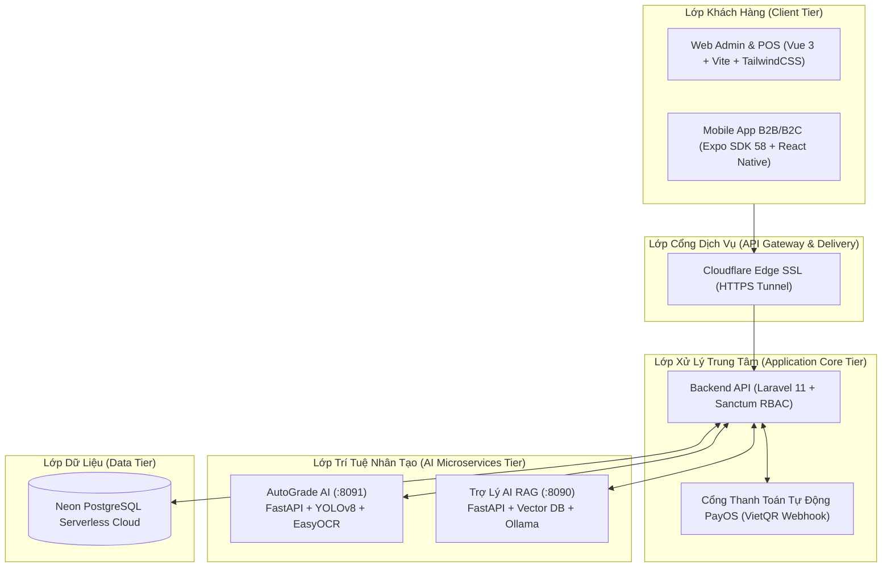

<div align="center">

# 📱 LIÊNG MOBILE — HỆ THỐNG QUẢN TRỊ CHUỖI BÁN LẺ & THẨM ĐỊNH AI

### Đồ án môn Quản Trị Dự Án Phần Mềm (VKU) • Sourcing Pathway 1

[](https://github.com/baopham1410/lieng-mobile-qtda/releases/tag/v1.0.0)
[-brightgreen.svg?style=for-the-badge&logo=githubactions)](https://github.com/baopham1410/lieng-mobile-qtda/actions)
[](https://github.com/users/baopham1410/projects/1)
[](https://vku.udn.vn)

<p align="center">
  <b>Nền tảng hợp nhất quản trị chuỗi bán lẻ thiết bị di động & không gian trải nghiệm Liêng Mobile, tích hợp AI thị giác máy tính thẩm định ngoại quan máy cũ (AutoGrade AI), Trợ lý nội bộ RAG và Cổng di động Khách hàng B2C 5 Tab.</b>
</p>

[🌐 Web Live 24/7 (Cloudflare Pages)](https://lieng-mobile-qtda.pages.dev) • [🎥 Video Demo (Google Drive)](https://drive.google.com/file/d/1c5fAd1nVGbjfWkS7eT8VqeswLRHsxPO0/view?usp=sharing) • [📱 Cổng Mobile Khách hàng (Live)](https://alt-steady-submit-drives.trycloudflare.com) • [📋 Bảng Quản trị Projects](https://github.com/users/baopham1410/projects/1) • [📦 Gói Bằng Chứng QLDA](docs/GOI_BANG_CHUNG_QLDA/README.md)

---

</div>

## 📌 Giới Thiệu & Bài Toán Doanh Nghiệp

**Liêng Mobile** giải quyết triệt để 3 bài toán nhức nhối trong chuỗi kinh doanh điện thoại đã qua sử dụng và không gian dịch vụ:
1. **Quản trị vận hành & Quầy bán hàng POS Serial/IMEI:** Chấm dứt thất thoát tồn kho và bán trùng máy nhờ cơ chế quản lý vòng đời IMEI chặt chẽ, thanh toán tự động VietQR qua Webhook PayOS sau 3.5 giây, cùng sổ quỹ kiểm đếm két Showroom minh bạch.
2. **AI Thẩm định & Định giá thu cũ (AutoGrade AI :8091):** Ứng dụng mô hình YOLOv8 tự động khoanh vùng các vị trí trầy xước, cấn móp, nứt vỡ từ ảnh chụp 6 góc máy kết hợp OCR đọc chu kỳ pin; tính toán khấu trừ minh bạch và sinh phiếu định giá sau 12 giây, loại bỏ định giá cảm tính.
3. **Cổng di động Khách hàng B2C & Trợ lý RAG (:8090):** Ứng dụng Mobile Expo 5 Tab cho phép khách hàng tra cứu bảo hành điện tử theo IMEI, tự ước tính giá thu cũ (+2.000.000 đ trợ giá), đặt giữ máy 24h và tích hợp Chatbot RAG tư vấn chính sách thông minh.

---

## 👥 Đội Ngũ Thực Hiện & Phân Vai Chuẩn VKU (100% Đóng Góp)

Dự án được thực hiện bởi nhóm **3 sinh viên**, phân bổ chuyên trách 5 vai trò kỹ thuật theo quy định môn học Quản trị dự án phần mềm với tỷ lệ đóng góp đồng đều:

| Thành viên | Tài khoản GitHub | Vai trò kỹ thuật đảm nhiệm | Khối lượng phụ trách chính | % Đóng góp |
| :--- | :--- | :--- | :--- | :---: |
| **Phạm Quốc Bảo** | [`@baopham1410`](https://github.com/baopham1410) | **Trưởng nhóm / Project Lead (PM) & Technical Lead** | Kiến trúc Monorepo, Database Neon Cloud, Backend API Laravel 11, Dịch vụ AI AutoGrade (:8091), Chatbot RAG (:8090) & CI/CD Pipeline. | **33.4%** |
| **Nguyễn Thị Hồng** | [`@Chimsedinang605`](https://github.com/Chimsedinang605) | **Scrum Master & Frontend Lead** | Điều phối Agile/Sprint, quản lý Backlog, phát triển Web Admin POS, Phân hệ Quán nhỏ, PayOS Webhook & kiểm soát Definition of Done. | **33.3%** |
| **Khổng Thị Lệ Giang** | [`@ktlgiang`](https://github.com/ktlgiang) | **Mobile Lead, UI/UX Designer & QA Test Engineer** | Thiết kế UI/UX Google Stitch, phát triển Mobile App Expo (B2B & B2C 5 Tab), xây dựng Ma trận kiểm thử QA Matrix & UAT thiết bị thật. | **33.3%** |

> 🤝 **Cam kết nhóm:** 100% đóng góp chia đều cho 3 thành viên (~33.3%/người), tuân thủ đúng cam kết trong **Project Charter Mục 10** và biên bản **Stakeholder Acceptance Signoff**.

---

## 🚀 Trải Nghiệm Sản Phẩm Chạy Thực Tế (Production Live URLs)

Hệ thống được triển khai trên nền tảng **Cloudflare Pages** (chạy 24/7 toàn cầu) và **Cloudflare Zero Trust Tunnel** bảo mật cao qua giao thức **HTTPS**:

| Phân hệ | Đường dẫn truy cập trực tiếp | Tài khoản trải nghiệm | Ghi chú vận hành |
| :--- | :--- | :--- | :--- |
| **🌐 Web Production (Cloudflare Pages)** | [https://lieng-mobile-qtda.pages.dev](https://lieng-mobile-qtda.pages.dev) | `admin` / `password` | **Bản Web Live chính thức 24/7** (Toàn bộ Web Admin, Quầy POS, Sổ quỹ, Thẩm định). |
| **🎥 Video Demo & Quy trình QLDA** | [Xem Video Demo (Google Drive)](https://drive.google.com/file/d/1c5fAd1nVGbjfWkS7eT8VqeswLRHsxPO0/view?usp=sharing) | Thời lượng ~4 phút | **Demo sản phẩm chạy thật & Quy trình quản lý task trên GitHub Projects.** |
| **💻 Web Admin & Quầy POS (Tunnel)** | [https://lane-mat-discounted-more.trycloudflare.com](https://lane-mat-discounted-more.trycloudflare.com) | `admin` / `password` | Quản lý kho IMEI, quầy POS thanh toán VietQR, Sổ quỹ két và phân hệ Quán. |
| **📱 Cổng Mobile Khách hàng & Bán hàng** | [https://alt-steady-submit-drives.trycloudflare.com](https://alt-steady-submit-drives.trycloudflare.com) | Khách hàng: Tự do<br>NV: `sales` / `password` | 5 Tab khách hàng B2C (Trang chủ, Cửa hàng, Thu cũ AI, Bảo hành, Tôi) & POS di động. |
| **📋 Bảng Quản lý Dự án (Kanban)** | [https://github.com/users/baopham1410/projects/1](https://github.com/users/baopham1410/projects/1) | Công khai (Public) | 5 Sprint, Backlog, Ready, In Progress, In Review, Done. |
| **🏷️ Bản Phát Hành v1.0.0** | [Release v1.0.0 Tag](https://github.com/baopham1410/lieng-mobile-qtda/releases/tag/v1.0.0) | Đã tag chính thức | Đóng gói sản phẩm hoàn thiện phục vụ bảo vệ đồ án. |

---

## 🏗️ Kiến Trúc Hệ Thống (Decoupled Monorepo)



---

## 📊 Chỉ Số Thực Thi Agile & Chất Lượng (Quality Gates)

- **Vận tốc nhóm qua 5 Sprint:** Sprint 1 (42 SP) ➔ Sprint 2 (48 SP) ➔ Sprint 3 (39 SP) ➔ Sprint 4 (35 SP) ➔ **Sprint 5 (73 SP)**.
- **Tổng điểm Story Points:** Đạt **237 / 275 SP (86.2%)** trên toàn bộ Product Backlog.
- **Khối lượng thực thi:** **170 Pull Requests** được kiểm duyệt chéo (Peer Review) và hợp nhất vào nhánh `main`.
- **Đường ống CI/CD (GitHub Actions):** Tự động kích hoạt kiểm tra 3/3 jobs trên mọi PR:
  - 🟢 `Backend (Laravel)`: Linting, Unit test & kiểm tra cú pháp PHP 8.2+.
  - 🟢 `Frontend (Vue / Vite)`: Kiểm tra cấu trúc bundle, dependencies & build test.
  - 🟢 `Mobile (Expo)`: Typecheck toàn diện TypeScript (`tsc --noEmit`).
- **Quy trình Definition of Done (DoD):** Issue WBS ➔ Feature Branch ➔ Self-test notes ➔ 3/3 Jobs CI xanh ➔ Tối thiểu 01 thành viên Review & Approve ➔ Merge `main`.

---

## 📁 Cấu Trúc Mã Nguồn (Monorepo Directory)

```text
lieng-mobile-qtda/
├── backend/                  # Laravel 11 API, Sanctum Auth, PayOS Webhook, POS Service
├── frontend/                 # Vue 3 SPA, Vite, TailwindCSS, Pinia (Admin & Quầy POS)
├── mobile-expo/              # Expo SDK 58, React Native, Camera Scanner, Cổng B2C 5 Tab
├── autograde-service/        # Microservice FastAPI (:8091) + YOLOv8 chẩn đoán lỗi ngoại quan
├── assistant-service/        # Microservice FastAPI (:8090) + LangChain RAG & Ollama tư vấn
├── docs/                     # Toàn bộ tài liệu phân tích nghiệp vụ, WBS và gói bằng chứng QLDA
│   └── GOI_BANG_CHUNG_QLDA/  # 8 Hạng mục hồ sơ nghiệm thu chính thức chuẩn nộp Google Drive
├── docker/                   # Docker Compose cấu hình môi trường Containerized
└── .github/                  # GitHub Actions CI Workflows, Issue & PR Templates
```

---

## 🛠️ Hướng Dẫn Cài Đặt & Chạy Cục Bộ (Local Setup)

### Yêu cầu tiên quyết
- **PHP:** >= 8.2 & Composer
- **Node.js:** >= 20.x & pnpm / npm
- **Python:** >= 3.10
- **Database:** PostgreSQL (Khuyên dùng Neon PostgreSQL Serverless Cloud)

### 1. Khởi động Backend API (Laravel 11)
```bash
cd backend
composer install
cp .env.example .env      # Cấu hình chuỗi kết nối Neon PostgreSQL và PayOS API
php artisan key:generate
php artisan migrate --seed
php -S 0.0.0.0:8080 -t public server.php
```

### 2. Khởi động Web Admin & POS (Vue 3)
```bash
cd frontend
npm install
npm run dev -- --host 0.0.0.0 --port 5173
```
*Truy cập Web Admin tại: `http://localhost:5173`*

### 3. Khởi động Mobile App (Expo SDK 58)
```bash
cd mobile-expo
npm install
npx expo start --tunnel   # Quét mã QR bằng Expo Go trên iOS/Android
```
*Hoặc mở bản Web PWA tại: `http://localhost:8085`*

### 4. Khởi động Dịch vụ AI AutoGrade (:8091) & Chatbot (:8090)
```bash
# AutoGrade YOLOv8 Service
cd autograde-service
python -m venv .venv
source .venv/bin/activate  # Trên Windows: .\.venv\Scripts\activate
pip install -r requirements.txt
python -m uvicorn app.main:app --host 127.0.0.1 --port 8091

# Chatbot Assistant RAG Service
cd ../assistant-service
python -m venv .venv
source .venv/bin/activate  # Trên Windows: .\.venv\Scripts\activate
pip install -r requirements.txt
python -m uvicorn app.main:app --host 127.0.0.1 --port 8090
```

### 🐳 Khởi động nhanh bằng Docker (Tùy chọn)
```bash
docker compose up -d --build
```

---

## 📑 Danh Mục Gói Bằng Chứng QLDA (8 Deliverables)

Hồ sơ bàn giao nghiệm thu hoàn chỉnh được lưu trữ tại thư mục [`docs/GOI_BANG_CHUNG_QLDA/`](docs/GOI_BANG_CHUNG_QLDA/README.md) bao gồm:

1. 📄 **`01_Final_Technical_Report.docx`**: Báo cáo kỹ thuật tổng kết toàn diện (20 trang).
2. 📄 **`02_Project_Charter_Signed.docx`**: Điều lệ dự án đã ký phê duyệt (Mục 1 đến Mục 13).
3. 📄 **`03_WBS_and_WBS_Dictionary.docx`**: Cây phân rã công việc tuân thủ nghiêm ngặt Quy tắc 100%.
4. 📊 **`04_Risk_Register_Evolution.xlsx`**: Ma trận tiến hóa 10 rủi ro (Trước vs Sau xử lý).
5. 📄 **`05_Sprint_Retrospectives.docx`**: Biên bản họp cải tiến 5 Sprint liên tục (Scrum Retrospective).
6. 📄 **`06_Scope_Change_Control_Record.docx`**: Hồ sơ kiểm soát 5 phiếu thay đổi phạm vi (CR-001 đến CR-005).
7. 📄 **`07_Stakeholder_Acceptance_Signoff.docx`**: Biên bản nghiệm thu chấp thuận người dùng UAT đã ký.
8. 📄 **`08_Presentation_Slide_Deck.docx`**: Bộ Slide thuyết trình 15 slide chuẩn bảo vệ đồ án.

---

<div align="center">
  <b>© 2026 Liêng Mobile Team — Trường Đại học Công nghệ Thông tin & Truyền thông Việt - Hàn (VKU)</b>
</div>
