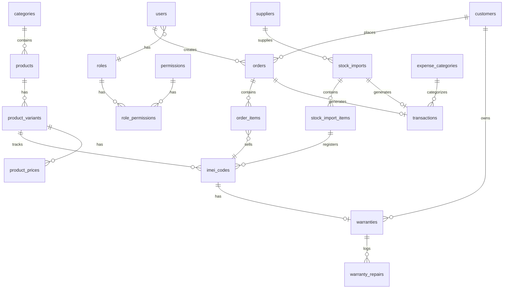

# Thiết Kế Cơ Sở Dữ Liệu

## Sơ đồ quan hệ (ERD)



## Tổng quan

| | Số lượng |
|---|----------|
| Bảng nghiệp vụ | 22 |
| Bảng hệ thống Laravel | 4 (`migrations`, `password_resets`, `failed_jobs`, `personal_access_tokens`) |
| **Tổng** | **23 bảng** trên Neon PostgreSQL |

Schema chạy bằng: `php artisan migrate --seed`

---

## Cách dùng từng bảng

### 1. Hệ thống & đăng nhập

#### `users` — Nhân viên / Admin
Lưu tài khoản đăng nhập hệ thống.

| Ai dùng | Khi nào |
|---------|---------|
| Admin | Tạo / sửa / khóa nhân viên |
| Mọi người | Đăng nhập Web hoặc Mobile |

**Ví dụ:** `admin@liengmobile.com` — quản lý cửa hàng.

#### `roles` — Vai trò
Phân loại quyền: `admin`, `sales_staff`, `warehouse_staff`.

| Ai dùng | Khi nào |
|---------|---------|
| Hệ thống | Kiểm tra quyền mỗi request API |
| Admin | Gán role cho user |

#### `permissions` + `role_permissions` — Quyền chi tiết
Gán quyền theo module: `products.view`, `orders.create`, `finance.reports`...

| Ai dùng | Khi nào |
|---------|---------|
| Hệ thống | Middleware kiểm tra quyền |
| Admin | Cấu hình quyền cho từng role |

**Trạng thái:** Bảng đã có, chưa seed quyền chi tiết.

#### `personal_access_tokens` — Token đăng nhập (Sanctum)
Lưu token sau khi login — FE/Mobile gửi kèm header mỗi request.

**Luồng:** Login → tạo token → Logout → xóa token.

#### `password_resets` — Quên mật khẩu
Lưu token reset password (Laravel mặc định). Dùng khi user bấm "Quên mật khẩu".

#### `failed_jobs` — Job thất bại
Ghi log queue job bị lỗi. Dùng khi bật queue (email hóa đơn, báo cáo nền...).

#### `migrations` — Theo dõi migration
Laravel dùng nội bộ — biết migration nào đã chạy. Không liên quan nghiệp vụ.

---

### 2. Sản phẩm

#### `categories` — Danh mục
Nhóm sản phẩm: Điện thoại, Laptop, Tablet, Phụ kiện...

| Ai dùng | Khi nào |
|---------|---------|
| Admin | Tạo / sửa danh mục |
| FE | Lọc sản phẩm theo danh mục |

#### `products` — Sản phẩm (dòng máy)
Thông tin chung một dòng sản phẩm — **không phải từng máy cụ thể**.

| Cột | Ví dụ |
|-----|-------|
| `name` | iPhone 15 Pro Max |
| `brand` | Apple |
| `model_code` | A3101 |

Một product có nhiều biến thể (màu, dung lượng).

#### `product_variants` — Biến thể
Chi tiết cấu hình từng loại trong cùng một product.

| Cột | Ví dụ |
|-----|-------|
| `color` | Titan Xanh |
| `storage` | 256GB |
| `ram` | 8GB |
| `condition` | new / likenew_99 / used |
| `sku` | IP15PM-256-TITAN |

**Khi nào:** Admin tạo sản phẩm → thêm biến thể → nhập kho theo biến thể.

#### `product_prices` — Giá đa tầng

| `price_type` | Ý nghĩa |
|--------------|---------|
| `import` | Giá nhập kho |
| `retail` | Giá bán lẻ |
| `wholesale` | Giá bán sỉ |

**Ví dụ:** iPhone 256GB — nhập 22tr, bán lẻ 25tr, sỉ 23.5tr.

---

### 3. Kho & IMEI

#### `suppliers` — Nhà cung cấp
Thông tin nơi nhập hàng (tên, SĐT, địa chỉ). Dùng khi tạo phiếu nhập.

#### `stock_imports` — Phiếu nhập kho
Một lần nhập hàng từ nhà cung cấp.

| Cột | Ý nghĩa |
|-----|---------|
| `code` | PN-20250613-001 |
| `supplier_id` | Nhà cung cấp |
| `total_amount` | Tổng tiền nhập |
| `status` | draft → confirmed |

**Luồng:** NV kho tạo phiếu → nạp IMEI → xác nhận → tự tạo phiếu chi (`transactions`).

#### `stock_import_items` — Chi tiết phiếu nhập
Mỗi dòng = một biến thể + số lượng + đơn giá nhập.

**Ví dụ:** Phiếu nhập 5 chiếc iPhone 256GB Titan, giá nhập 22tr/cái.

#### `imei_codes` — Mã IMEI từng máy (bảng trung tâm)
Theo dõi **từng chiếc máy** — mỗi IMEI = một dòng.

| `status` | Nghĩa |
|----------|-------|
| `in_stock` | Trong kho, sẵn sàng bán |
| `sold` | Đã bán |
| `defective` | Máy lỗi |
| `warranty` | Đang bảo hành |

**Luồng:**
- Nhập kho → tạo IMEI `in_stock`
- Bán POS → chọn IMEI → chuyển `sold`
- Tra cứu bảo hành → tìm theo IMEI

---

### 4. Bán hàng (POS)

#### `customers` — Khách hàng
Hồ sơ KH: SĐT, email, điểm tích lũy, lịch sử mua.

| Ai dùng | Khi nào |
|---------|---------|
| NV bán hàng | Tạo KH mới hoặc chọn KH lúc checkout |
| Admin | Xem lịch sử mua |

#### `orders` — Đơn hàng / Hóa đơn
Một lần bán hàng tại POS.

| Cột | Ý nghĩa |
|-----|---------|
| `code` | HD-20250613-001 |
| `total` | Tổng tiền |
| `payment_method` | cash / transfer / ewallet |
| `status` | draft → completed |

**Luồng:** Tạo đơn → thêm sản phẩm + IMEI → checkout → ghi thu tiền.

#### `order_items` — Chi tiết đơn hàng
Mỗi dòng = một máy bán ra, gắn **một IMEI duy nhất**.

**Quy tắc:** 1 `order_item` ↔ 1 `imei_code` — không bán trùng IMEI.

---

### 5. Thu chi & Tài chính

#### `expense_categories` — Loại chi phí

| Ví dụ | `type` |
|-------|--------|
| Nhập hàng | import |
| Mặt bằng, Lương, Điện nước | operating |
| Khác | other |

#### `transactions` — Sổ quỹ (Thu / Chi)
Mọi dòng tiền vào/ra cửa hàng.

| `type` | Nguồn |
|--------|-------|
| `income` | Bán hàng — tự động từ `orders` |
| `expense` | Nhập hàng từ `stock_imports` hoặc phiếu chi thủ công |

**Dùng cho:** Báo cáo doanh thu, lãi/lỗ theo ngày / tuần / tháng.

---

### 6. Bảo hành

#### `warranties` — Phiếu bảo hành
Gắn bảo hành cho máy đã bán.

| Cột | Ý nghĩa |
|-----|---------|
| `imei_code_id` | Máy nào |
| `customer_id` | Khách nào |
| `start_date` / `end_date` | Thời hạn BH |

**Khi nào:** Checkout xong → tự tạo warranty cho từng IMEI đã bán.

#### `warranty_repairs` — Lịch sử sửa chữa
Ghi mỗi lần máy vào bảo hành / sửa chữa (mô tả lỗi, chi phí, ngày sửa).

---

## Luồng nghiệp vụ theo bảng

### Nhập kho

```
suppliers
    ↓
stock_imports ──→ transactions (expense)
    ↓
stock_import_items
    ↓
imei_codes (status: in_stock)
```

### Bán hàng POS

```
customers
    ↓
orders ──→ transactions (income)
    ↓
order_items ──→ imei_codes (status: sold)
                    ↓
               warranties
                    ↓
              warranty_repairs
```

### Thiết lập sản phẩm (trước khi nhập/bán)

```
categories → products → product_variants → product_prices
                              ↓
                         imei_codes (khi nhập kho)
```

### Đăng nhập

```
users → roles → permissions / role_permissions
         ↓
personal_access_tokens
```

---

## Trạng thái dữ liệu hiện tại (sau seed)

| Bảng | Dữ liệu |
|------|---------|
| `roles` | 3 — admin, sales_staff, warehouse_staff |
| `users` | 1 — admin@liengmobile.com |
| `categories` | 4 — Điện thoại, Laptop, Tablet, Phụ kiện |
| `expense_categories` | 5 — Nhập hàng, Mặt bằng, Lương... |
| `permissions` | 0 — chưa seed |
| Các bảng còn lại | Trống — chờ nhập qua app |

---

## Bảng dữ liệu (chi tiết cột)

### 1. Người dùng & Phân quyền

#### `users`
| Cột | Kiểu | Mô tả |
|-----|------|-------|
| id | BIGINT PK | |
| name | VARCHAR(100) | Họ tên |
| email | VARCHAR(255) UNIQUE | |
| password | VARCHAR(255) | |
| phone | VARCHAR(20) | |
| role_id | BIGINT FK → roles | |
| is_active | BOOLEAN | |
| timestamps | | |

#### `roles`
| Cột | Kiểu | Mô tả |
|-----|------|-------|
| id | BIGINT PK | |
| name | VARCHAR(50) UNIQUE | admin, sales_staff, warehouse_staff |
| display_name | VARCHAR(100) | |

#### `permissions` + `role_permissions`
Phân quyền chi tiết theo module: `products.view`, `orders.create`, `finance.reports`...

---

### 2. Sản phẩm

#### `categories`
| Cột | Kiểu | Mô tả |
|-----|------|-------|
| id | BIGINT PK | |
| name | VARCHAR(100) | Điện thoại, Laptop, Phụ kiện... |
| slug | VARCHAR(100) UNIQUE | |
| parent_id | BIGINT FK nullable | Danh mục con |

#### `products`
| Cột | Kiểu | Mô tả |
|-----|------|-------|
| id | BIGINT PK | |
| category_id | BIGINT FK | |
| name | VARCHAR(255) | iPhone 15 Pro Max |
| brand | VARCHAR(100) | Apple, Samsung... |
| model_code | VARCHAR(100) | A3101 |
| description | TEXT | |
| is_active | BOOLEAN | |
| timestamps | | |

#### `product_variants`
Biến thể: màu + dung lượng + RAM + tình trạng

| Cột | Kiểu | Mô tả |
|-----|------|-------|
| id | BIGINT PK | |
| product_id | BIGINT FK | |
| sku | VARCHAR(100) UNIQUE | |
| color | VARCHAR(50) | |
| storage | VARCHAR(20) | 128GB, 256GB |
| ram | VARCHAR(20) | 8GB, 12GB |
| condition | VARCHAR | new, likenew_99, used |
| timestamps | | |

#### `product_prices`
Giá đa tầng

| Cột | Kiểu | Mô tả |
|-----|------|-------|
| id | BIGINT PK | |
| product_variant_id | BIGINT FK | |
| price_type | VARCHAR | import, retail, wholesale |
| amount | DECIMAL(15,2) | |
| effective_from | DATE | |
| effective_to | DATE nullable | |

---

### 3. IMEI / Serial

#### `imei_codes`
**Bảng trung tâm** — mỗi máy một dòng

| Cột | Kiểu | Mô tả |
|-----|------|-------|
| id | BIGINT PK | |
| product_variant_id | BIGINT FK | |
| imei | VARCHAR(20) UNIQUE | Mã IMEI/Serial |
| status | VARCHAR | in_stock, sold, defective, warranty |
| stock_import_item_id | BIGINT FK nullable | Nguồn nhập |
| order_item_id | BIGINT FK nullable | Đơn bán |
| import_cost | DECIMAL(15,2) | Giá nhập thực tế |
| notes | TEXT | |
| timestamps | | |

**Index**: `imei`, `status`, `product_variant_id`

---

### 4. Kho & Nhập hàng

#### `suppliers`
| Cột | Kiểu | Mô tả |
|-----|------|-------|
| id | BIGINT PK | |
| name | VARCHAR(255) | |
| phone | VARCHAR(20) | |
| email | VARCHAR(255) | |
| address | TEXT | |

#### `stock_imports` (Phiếu nhập)
| Cột | Kiểu | Mô tả |
|-----|------|-------|
| id | BIGINT PK | |
| code | VARCHAR(50) UNIQUE | PN-20250613-001 |
| supplier_id | BIGINT FK | |
| user_id | BIGINT FK | Người tạo |
| total_amount | DECIMAL(15,2) | |
| status | VARCHAR | draft, confirmed, cancelled |
| imported_at | DATETIME | |
| notes | TEXT | |
| timestamps | | |

#### `stock_import_items`
| Cột | Kiểu | Mô tả |
|-----|------|-------|
| id | BIGINT PK | |
| stock_import_id | BIGINT FK | |
| product_variant_id | BIGINT FK | |
| quantity | INT | |
| unit_cost | DECIMAL(15,2) | |
| subtotal | DECIMAL(15,2) | |

---

### 5. Bán hàng (POS)

#### `customers`
| Cột | Kiểu | Mô tả |
|-----|------|-------|
| id | BIGINT PK | |
| name | VARCHAR(100) | |
| phone | VARCHAR(20) UNIQUE | |
| email | VARCHAR(255) | |
| address | TEXT | |
| loyalty_points | INT DEFAULT 0 | |
| timestamps | | |

#### `orders`
| Cột | Kiểu | Mô tả |
|-----|------|-------|
| id | BIGINT PK | |
| code | VARCHAR(50) UNIQUE | HD-20250613-001 |
| customer_id | BIGINT FK nullable | |
| user_id | BIGINT FK | Nhân viên bán |
| subtotal | DECIMAL(15,2) | |
| discount | DECIMAL(15,2) | |
| total | DECIMAL(15,2) | |
| payment_method | VARCHAR | cash, transfer, ewallet |
| status | VARCHAR | draft, completed, cancelled, refunded |
| paid_at | DATETIME | |
| notes | TEXT | |
| timestamps | | |

#### `order_items`
| Cột | Kiểu | Mô tả |
|-----|------|-------|
| id | BIGINT PK | |
| order_id | BIGINT FK | |
| product_variant_id | BIGINT FK | |
| imei_code_id | BIGINT FK UNIQUE | 1 IMEI = 1 item |
| unit_price | DECIMAL(15,2) | |
| discount | DECIMAL(15,2) | |
| total | DECIMAL(15,2) | |

---

### 6. Thu Chi & Tài chính

#### `expense_categories`
| Cột | Kiểu | Mô tả |
|-----|------|-------|
| id | BIGINT PK | |
| name | VARCHAR(100) | Nhập hàng, Mặt bằng, Lương, Điện nước... |
| type | VARCHAR | operating, import, other |

#### `transactions`
Sổ quỹ — mọi dòng tiền vào/ra

| Cột | Kiểu | Mô tả |
|-----|------|-------|
| id | BIGINT PK | |
| code | VARCHAR(50) UNIQUE | |
| type | VARCHAR | income, expense |
| amount | DECIMAL(15,2) | |
| payment_method | VARCHAR | cash, transfer, ewallet |
| category_id | BIGINT FK nullable | expense_categories |
| reference_type | VARCHAR(50) | Order, StockImport, Manual |
| reference_id | BIGINT | Polymorphic |
| user_id | BIGINT FK | |
| description | TEXT | |
| transacted_at | DATETIME | |
| timestamps | | |

---

### 7. Bảo hành

#### `warranties`
| Cột | Kiểu | Mô tả |
|-----|------|-------|
| id | BIGINT PK | |
| imei_code_id | BIGINT FK UNIQUE | |
| customer_id | BIGINT FK | |
| order_id | BIGINT FK | |
| start_date | DATE | |
| end_date | DATE | |
| warranty_months | INT | 12, 24... |
| status | VARCHAR | active, expired, void |

#### `warranty_repairs`
| Cột | Kiểu | Mô tả |
|-----|------|-------|
| id | BIGINT PK | |
| warranty_id | BIGINT FK | |
| description | TEXT | Mô tả sửa chữa |
| cost | DECIMAL(15,2) | Chi phí (nếu có) |
| repaired_at | DATETIME | |
| user_id | BIGINT FK | Nhân viên xử lý |

---

## Quy tắc toàn vẹn dữ liệu

1. **IMEI duy nhất** — Không trùng lặp trên toàn hệ thống.
2. **Trạng thái IMEI** — Chỉ chuyển `in_stock → sold` qua Order; không sửa trực tiếp.
3. **Đồng bộ tài chính** — Mỗi Order completed tạo 1 Transaction income; mỗi StockImport confirmed tạo 1 Transaction expense.
4. **Soft delete** — Products, Customers dùng soft delete; Orders/Transactions không xóa, chỉ cancel/refund.

## Schema trong code

Schema chính thức: **`backend/database/migrations/`** — chạy bằng `php artisan migrate`.

Xem thứ tự: [`backend/MIGRATION_ORDER.md`](../backend/MIGRATION_ORDER.md)
