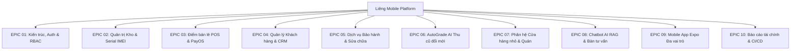

# Liêng Mobile — Product Backlog & Quản Lý Dự Án (Agile / Scrum)

> **Dự án:** Hệ thống Quản trị Chuỗi Cửa hàng Điện thoại & Phân hệ Quán nhỏ (Liêng Mobile)  
> **Repository:** `baopham1410/lieng-mobile-qtda`  
> **Môn học:** Quản trị Dự án Phần mềm (QTDA)  
> **Phương pháp luận:** Agile / Scrum  
> **Cập nhật lần cuối:** 13/11/2026  
> **Nhóm thực hiện:**  
> - **Phạm Quốc Bảo** (`baopham1410`) — Product Owner / Tech Lead / Backend & AI Lead  
> - **Nguyễn Thị Hồng** (`Chimsedinang605`) — Scrum Master / Frontend Lead & Quán Module Lead  
> - **Khổng Thị Lệ Giang** (`ktlgiang`) — Mobile Lead / UI/UX Designer & QA  

---

## 1. Tầm Nhìn Sản Phẩm & Mục Tiêu Dự Án (Product Vision)

### 1.1. Tuyên ngôn Tầm nhìn (Product Vision Statement)
> *"Đối với các chuỗi cửa hàng bán lẻ thiết bị di động kết hợp không gian trải nghiệm tiện ích, **Liêng Mobile** là nền tảng quản trị hợp nhất (Web Admin + Mobile App + AI Diagnostics) cung cấp khả năng quản lý chính xác từng cá thể máy theo IMEI, thanh toán nhanh POS với mã VietQR PayOS, chẩn đoán & định giá tự động máy cũ bằng thị giác máy tính AI (AutoGrade), cùng trợ lý AI RAG nội bộ. Khác với các phần mềm bán lẻ truyền thống phân mảnh, Liêng Mobile liên kết chặt chẽ toàn bộ vòng đời thiết bị từ khi nhập kho, bán ra tại quầy, bảo hành, thẩm định thu mua, đến dòng tiền bán hàng & tiện ích một cách nhất quán, minh bạch và bảo mật theo vai trò."*

### 1.2. Mục tiêu cốt lõi (Core Business Objectives)
1. **Kiểm soát tuyệt đối tồn kho Serial/IMEI**: Mỗi chiếc điện thoại từ lúc nhập kho đến khi xuất bán, bảo hành và thu cũ đều được định danh bằng mã IMEI 15 chữ số, loại bỏ 100% tình trạng bán trùng máy hoặc tồn ảo.
2. **Tối ưu tốc độ bán hàng tại quầy POS**: Nhân viên chỉ mất dưới 30 giây để hoàn tất đơn hàng với thao tác chọn máy, gõ SĐT khách và tạo mã VietQR động thanh toán tự động qua ngân hàng (PayOS).
3. **Chuẩn hóa quy trình Thu Cũ Đổi Mới bằng AI (AutoGrade)**: Tự động phân loại ngoại quan (Hạng S/A/B/C) qua YOLOv8, trích xuất chu kỳ pin/màn hình qua OCR và áp dụng bảng tính khấu trừ minh bạch.
4. **Phân quyền vai trò chặt chẽ (RBAC)**: Tách biệt rõ ràng quyền hạn giữa Admin, Nhân viên bán hàng, Nhân viên kho, Quản lý Quán và Nhân viên Quán; áp dụng đồng nhất từ backend API, Web Admin đến Mobile App.
5. **Hợp nhất trải nghiệm Omnichannel**: Vận hành đồng thời trên Web quản trị tập trung và Mobile App di động phục vụ ca trực tại quầy showroom.

---

## 2. Quy Chuẩn Xây Dựng Product Backlog (Backlog Standards)

### 2.1. Cấu trúc User Story
Mọi hạng mục yêu cầu người dùng (Product Backlog Item - PBI) được đặc tả theo mẫu chuẩn:
$$\text{As a } [\text{Role/Persona}], \text{ I want } [\text{Action/Capability}], \text{ so that } [\text{Business Value/Benefit}]$$

### 2.2. Thang ước lượng Story Points (Fibonacci)
Dự án sử dụng dãy số Fibonacci để đánh giá độ phức tạp, khối lượng công việc và rủi ro:
- **1 SP**: Tác vụ rất nhỏ, sửa nhãn text, icon, điều chỉnh style nhỏ (< 2 giờ).
- **2 SP**: Chức năng đơn giản, form nhập liệu cơ bản, component UI tĩnh (2–4 giờ).
- **3 SP**: Chức năng vừa phải, CRUD cơ bản kết nối API, modal nghiệp vụ (4–8 giờ).
- **5 SP**: Nghiệp vụ trung bình-khó, xử lý logic phức tạp, form nhiều bước, state management (1–2 ngày).
- **8 SP**: Tính năng lớn, tích hợp bên thứ ba (PayOS, AI inference), phân quyền chuyên sâu (2–3 ngày).
- **13 SP**: Epic hoặc module phức tạp cao, tích hợp đa nền tảng Web + Mobile + AI (cần phân rã nhỏ hơn).

### 2.3. Mức độ ưu tiên theo MoSCoW
- **Must have (M)**: Bắt buộc phải có để hệ thống có thể vận hành và bàn giao nghiệm thu.
- **Should have (S)**: Cần thiết và mang lại giá trị cao, nên hoàn thiện trong phiên bản chính.
- **Could have (C)**: Tính năng hữu ích nâng cao trải nghiệm, thực hiện khi còn dư năng lực Sprint.
- **Won't have (W)**: Tạm hoãn sang các bản phát hành tiếp theo (Future Backlog / Release 2.0).

### 2.4. Tiêu chuẩn Sẵn sàng (Definition of Ready - DoR)
1. User Story có đầy đủ mô tả cấu trúc `As a... I want... So that...`.
2. Có danh sách tiêu chí nghiệm thu rõ ràng (Acceptance Criteria - AC).
3. Đã xác định rõ đối tượng người dùng / vai trò phân quyền (Role).
4. Đã ước lượng điểm Story Points bởi nhóm phát triển.
5. Không có blocker kỹ thuật hoặc phụ thuộc chưa được giải quyết.

### 2.5. Tiêu chuẩn Hoàn thành (Definition of Done - DoD)
1. Mã nguồn tuân thủ coding standards và quy ước Conventional Commits (`feat:`, `fix:`, `docs:`, `chore:`).
2. Kiểm tra biên dịch và typecheck thành công:
   - Frontend: `npm run build` không lỗi.
   - Backend: `php artisan test --env=testing` pass 100%.
   - Mobile: `npx tsc --noEmit` pass 0 lỗi.
3. Code được đẩy qua nhánh tính năng (`feature/*`) và tạo Pull Request vào `main`.
4. CI GitHub Actions (3 jobs: Frontend Vite, Backend Laravel, Mobile Expo) chạy xanh.
5. Được ít nhất 1 thành viên khác trong nhóm review và Approve (Peer Review).
6. Cập nhật tài liệu kỹ thuật liên quan và trạng thái trên GitHub Project Board.

---

## 3. Danh Mục Các Epics Cốt Lõi (10 Product Epics)

- **EPIC 01: Kiến trúc Nền tảng, Xác thực & Phân quyền RBAC (Platform, Auth & RBAC)**  
  Hệ thống quản lý định danh người dùng qua Sanctum, phân quyền chi tiết cho 5 vai trò (`admin`, `sales_staff`, `warehouse_staff`, `quan_manager`, `quan_staff`), middleware bảo vệ API và điều hướng màn hình phù hợp theo vai trò.
- **EPIC 02: Quản lý Danh mục, Sản phẩm & Quản trị kho IMEI chuyên sâu (Inventory & IMEI Hub)**  
  Quản lý danh mục đa cấp, sản phẩm đa biến thể, quản lý vòng đời từng số IMEI (`in_stock`, `sold`, `warranty`, `trade_in`), lập phiếu nhập kho, nạp IMEI số lượng lớn và xác nhận nhập kho sinh giao dịch chi phí tự động.
- **EPIC 03: Điểm bán lẻ POS & Động cơ Thanh toán đa phương thức (Retail POS & Checkout)**  
  Giao diện quầy bán hàng POS tốc độ cao, quét/chọn máy theo IMEI, áp dụng chiết khấu/voucher, tích hợp thanh toán tiền mặt, chuyển khoản VietQR tự động qua PayOS Webhook và in hóa đơn nhiệt.
- **EPIC 04: Quản lý Khách hàng, Lịch sử giao dịch & Hạng thành viên (CRM & Customer Care)**  
  Hồ sơ khách hàng tập trung, lịch sử đơn hàng, phiếu bảo hành và phiếu thẩm định máy cũ; phân hạng khách hàng (Đồng, Bạc, Vàng, Kim Cương, Vãng lai); ghi chú nội bộ và xuất báo cáo CSV.
- **EPIC 05: Dịch vụ Bảo hành thiết bị & Tiếp nhận sửa chữa (Warranty & Repair Hub)**  
  Tra cứu thời hạn bảo hành điện tử theo IMEI 15 số; lập phiếu tiếp nhận sửa chữa phần cứng/phần mềm; quản lý tiến độ xử lý và bàn giao thiết bị cho khách hàng.
- **EPIC 06: AutoGrade AI — Phân loại & Định giá thu cũ đổi mới (AI Diagnostics & Trade-in)**  
  Dịch vụ AI thị giác máy tính YOLOv8 phân loại ngoại quan 6 góc chụp, OCR nhận diện thông số pin/màn hình, áp dụng bảng giá trade-in khấu hao linh kiện tự động và sinh biên bản thẩm định.
- **EPIC 07: Phân hệ Cửa hàng nhỏ & Tiện ích trải nghiệm (Quán Small Store & Daily Statements)**  
  Giải pháp vận hành tinh gọn phục vụ quầy F&B/tiện ích trải nghiệm khách hàng tại showroom: bán nhanh không cần IMEI, ghi nhận chi phí phát sinh, chốt sổ sao kê ngày và lưu trữ kho sao kê.
- **EPIC 08: Chatbot AI Trợ lý nội bộ & Bàn tiếp nhận tư vấn khách (RAG Assistant & Consult Desk)**  
  Hệ thống AI Chatbot RAG sử dụng Ollama và Knowledge Base tài liệu nội bộ; hỗ trợ bot ngoài tư vấn chính sách cho khách hàng và bot trong hỗ trợ nhân viên tra cứu tồn kho, doanh thu; bàn tư vấn hotline tiếp nhận cuộc gọi.
- **EPIC 09: Ứng dụng Di động Đa vai trò (Mobile App Expo - Retail & Customer)**  
  Ứng dụng di động Expo React Native chuẩn giao diện Google Stitch, tích hợp thanh điều hướng tab thông minh theo vai trò người dùng (Bán hàng, Kho, Quán, Khách hàng) và tối ưu hóa trải nghiệm cảm ứng.
- **EPIC 10: Báo cáo tài chính, Phân tích dữ liệu & Hạ tầng CI/CD (Analytics, DevOps & Quality)**  
  Dashboard chỉ số kinh doanh thời gian thực, biểu đồ doanh thu - chi phí - lợi nhuận gộp theo kỳ, cấu hình CI/CD GitHub Actions 3 luồng kiểm thử tự động, Docker Compose và tài liệu QLDA.

---

## 4. Bảng Product Backlog Toàn Diện (Product Backlog Table)

| Mã PBI | Thuộc Epic | Tên User Story / Yêu cầu nghiệp vụ | Vai trò | MoSCoW | SP | Sprint | Trạng thái | Issue / PR |
|:---|:---|:---|:---|:---:|:---:|:---:|:---:|:---|
| **PBI-01** | EPIC 01 | Khởi tạo kiến trúc Monorepo (`backend`, `frontend`, `mobile-expo`, `docs`) | Tech Lead | **Must** | 3 | Sprint 1 | **Done** | #42 / PR #75 |
| **PBI-02** | EPIC 01 | Thiết kế Database Schema PostgreSQL (Users, Roles, Products, Orders, IMEI) | Backend | **Must** | 5 | Sprint 1 | **Done** | #43 |
| **PBI-03** | EPIC 01 | Đăng nhập Sanctum, sinh Token và trả về thông tin Role & Permissions | Tất cả | **Must** | 3 | Sprint 1 | **Done** | #59 |
| **PBI-04** | EPIC 01 | Điều hướng sau đăng nhập (Role Redirect) & Lọc Sidebar theo quyền | Tất cả | **Must** | 5 | Sprint 1 | **Done** | #59 |
| **PBI-05** | EPIC 01 | Quản lý danh sách nhân viên, gán vai trò và cấp quyền tài khoản | Admin | **Should** | 5 | Sprint 2 | **Done** | #55 |
| **PBI-06** | EPIC 01 | Màn hình Hồ sơ cá nhân: đổi mật khẩu, cập nhật avatar và nhật ký hoạt động | Tất cả | **Could** | 3 | Sprint 2 | **Done** | #67 |
| **PBI-07** | EPIC 02 | CRUD Danh mục sản phẩm (điện thoại, phụ kiện, linh kiện) kèm biểu tượng | Kho / Admin | **Must** | 3 | Sprint 1 | **Done** | #50 |
| **PBI-08** | EPIC 02 | Quản lý danh sách Sản phẩm, biến thể cấu hình (màu sắc, bộ nhớ, SKU) | Kho / Admin | **Must** | 5 | Sprint 2 | **Done** | #49, #51 |
| **PBI-09** | EPIC 02 | Quản lý kho cá thể thiết bị theo Serial / số IMEI 15 chữ số | Kho / Admin | **Must** | 8 | Sprint 2 | **Done** | #105 |
| **PBI-10** | EPIC 02 | Lập phiếu nhập kho hàng hóa (Draft) và thêm danh sách sản phẩm | Kho / Admin | **Must** | 5 | Sprint 2 | **Done** | #52, #53 |
| **PBI-11** | EPIC 02 | Nạp danh sách số IMEI vào phiếu nhập và kiểm tra trùng lặp serial | Kho | **Must** | 5 | Sprint 2 | **Done** | #105 |
| **PBI-12** | EPIC 02 | Xác nhận phiếu nhập kho: tăng tồn kho IMEI và tự động sinh giao dịch chi phí | Kho / Admin | **Must** | 5 | Sprint 2 | **Done** | #53 |
| **PBI-13** | EPIC 03 | Giao diện Quầy bán hàng POS: chọn danh mục, tìm sản phẩm và chọn máy theo IMEI | Bán hàng | **Must** | 8 | Sprint 2 | **Done** | #60, #96 |
| **PBI-14** | EPIC 03 | Tìm kiếm và gắn khách hàng vào hóa đơn POS qua Số điện thoại | Bán hàng | **Must** | 3 | Sprint 2 | **Done** | #60 |
| **PBI-15** | EPIC 03 | Áp dụng chiết khấu giảm giá và chọn phương thức thanh toán (TM/CK/Hỗn hợp) | Bán hàng | **Must** | 5 | Sprint 2 | **Done** | #60 |
| **PBI-16** | EPIC 03 | Tạo đơn bán lẻ: trừ kho IMEI (`sold`), lưu giao dịch thu và in hóa đơn | Bán hàng | **Must** | 8 | Sprint 2 | **Done** | #60 |
| **PBI-17** | EPIC 03 | Tích hợp cổng thanh toán VietQR động PayOS và tự động khớp đơn qua Webhook | Bán hàng | **Should** | 8 | Sprint 4 | **Done** | #97 / PR #104 |
| **PBI-18** | EPIC 03 | Quản lý danh sách đơn hàng POS, xem chi tiết hóa đơn và hủy đơn hoàn kho | Bán hàng / Admin | **Must** | 5 | Sprint 2 | **Done** | #61 |
| **PBI-19** | EPIC 04 | Quản lý danh sách khách hàng, tìm kiếm debounce và phân trang server | Bán hàng / Admin | **Must** | 5 | Sprint 2 | **Done** | #62 |
| **PBI-20** | EPIC 04 | Thêm mới, chỉnh sửa hồ sơ khách hàng và lưu trữ ghi chú chăm sóc (`notes`) | Bán hàng | **Should** | 3 | Sprint 5 | **Done** | #151, #152 / PR #153 |
| **PBI-21** | EPIC 04 | Ngăn chi tiết khách hàng tích hợp 3 tab: Lịch sử đơn hàng, Bảo hành, Thẩm định | Bán hàng / Admin | **Should** | 5 | Sprint 5 | **Done** | #152 / PR #153 |
| **PBI-22** | EPIC 04 | Phân hạng khách hàng tự động (Đồng, Bạc, Vàng, Kim Cương) và xuất danh sách CSV | Admin | **Could** | 3 | Sprint 5 | **Done** | #152 / PR #153 |
| **PBI-23** | EPIC 05 | Tra cứu thông tin bảo hành điện tử theo số IMEI (thời hạn, tình trạng máy) | Tất cả | **Must** | 3 | Sprint 3 | **Done** | #56 |
| **PBI-24** | EPIC 05 | Lập phiếu tiếp nhận sửa chữa / bảo hành: mô tả lỗi, hiện trạng thiết bị | Bán hàng / Admin | **Must** | 5 | Sprint 3 | **Done** | #56 |
| **PBI-25** | EPIC 05 | Cập nhật tiến độ sửa chữa, linh kiện thay thế và xuất biên nhận giao máy | Kỹ thuật / Admin | **Should** | 3 | Sprint 4 | **Done** | #56 |
| **PBI-26** | EPIC 06 | Thiết kế kiến trúc AI AutoGrade: Microservice FastAPI (:8091) + PyTorch YOLOv8 | Tech Lead | **Must** | 8 | Sprint 5 | **Done** | #148 / PR #147 |
| **PBI-27** | EPIC 06 | Xây dựng Bảng định giá Trade-in iPhone và biểu khấu trừ linh kiện tự động | Admin | **Must** | 5 | Sprint 5 | **Done** | #149 / PR #147 |
| **PBI-28** | EPIC 06 | Chẩn đoán thị giác máy tính: phát hiện trầy xước, cấn móp màn hình & vỏ máy | Bán hàng / Admin | **Must** | 8 | Sprint 5 | **Done** | #112 |
| **PBI-29** | EPIC 06 | Trích xuất OCR thông số phần cứng: Chu kỳ sạc pin, dung lượng tối đa, Model | Bán hàng | **Should** | 5 | Sprint 5 | **Done** | #112 |
| **PBI-30** | EPIC 06 | Giao diện Web Thẩm định AutoGrade: hiển thị hộp nhận diện 6 góc & xuất biên bản | Bán hàng / Admin | **Must** | 8 | Sprint 5 | **Done** | #112 |
| **PBI-31** | EPIC 07 | Quầy bán nhanh Module Quán: lưới sản phẩm F&B, gọi món và thu tiền ngay | NV Quán | **Must** | 5 | Sprint 3 | **Done** | #64, #94 |
| **PBI-32** | EPIC 07 | Ghi nhận phiếu chi phí phát sinh trong ngày tại Quán (tiền mặt / chuyển khoản) | NV Quán | **Must** | 3 | Sprint 3 | **Done** | #63, #70 |
| **PBI-33** | EPIC 07 | Tổng kết số liệu thu - chi - tiền mặt - chuyển khoản trong ngày của Quán | Quản lý Quán | **Must** | 5 | Sprint 3 | **Done** | #64, #73 |
| **PBI-34** | EPIC 07 | Chốt sổ sao kê cuối ngày và lưu trữ vào Kho sao kê số hóa (`quan_statements`) | Quản lý Quán | **Must** | 5 | Sprint 3 | **Done** | #65, #71 |
| **PBI-35** | EPIC 07 | Xem lại lịch sử sao kê, xuất ảnh PNG sao kê và in báo cáo quyết toán quỹ | Quản lý Quán | **Should** | 3 | Sprint 3 | **Done** | #65, #74 |
| **PBI-36** | EPIC 08 | Xây dựng dịch vụ AI RAG Chatbot sử dụng Ollama, Vector KB tài liệu Monorepo | Tech Lead | **Should** | 8 | Sprint 5 | **Done** | #136, #137 |
| **PBI-37** | EPIC 08 | Widget Chatbot bóng nổi ngoài Intro: tư vấn chính sách cho khách hàng vãng lai | Khách hàng | **Should** | 5 | Sprint 5 | **Done** | #113, #138 |
| **PBI-38** | EPIC 08 | Chatbot hỗ trợ nhân viên nội bộ: tra cứu nhanh tồn kho, thủ tục và deep-link màn | Nhân viên | **Should** | 5 | Sprint 5 | **Done** | #113, #140 |
| **PBI-39** | EPIC 08 | Quầy tư vấn Admin (Consult Desk): tiếp nhận hotline cuộc gọi và lưu thông tin | Bán hàng | **Could** | 5 | Sprint 5 | **Done** | #130 |
| **PBI-40** | EPIC 09 | Khởi tạo ứng dụng di động React Native Expo SDK 54 (`mobile-expo`) | Mobile Lead | **Must** | 5 | Sprint 1 | **Done** | #46, #68 |
| **PBI-41** | EPIC 09 | Thiết kế lại Shell điều hướng 5 Tab chuẩn Google Stitch trên Mobile | Mobile Lead | **Must** | 5 | Sprint 5 | **Done** | #119 / PR #154 |
| **PBI-42** | EPIC 09 | Màn hình Trang chủ Mobile: KPI ca trực, lối tắt nghiệp vụ và đơn hàng gần đây | Nhân viên | **Must** | 5 | Sprint 5 | **Done** | #120 / PR #154 |
| **PBI-43** | EPIC 09 | Màn hình Quầy POS Mobile: tìm máy, quét mã vạch, giỏ hàng và thanh toán VietQR | Bán hàng | **Must** | 8 | Sprint 5 | **Done** | #121 / PR #154 |
| **PBI-44** | EPIC 09 | Màn hình Đơn hàng Mobile: danh sách hóa đơn trong ca, bộ lọc và chia sẻ biên lai | Bán hàng | **Must** | 5 | Sprint 5 | **Done** | #122 / PR #154 |
| **PBI-45** | EPIC 09 | Màn hình Dịch vụ Mobile: Hub tra cứu bảo hành IMEI và thẩm định thu cũ | Nhân viên | **Must** | 5 | Sprint 5 | **Done** | #123, #124 |
| **PBI-46** | EPIC 09 | Màn hình Thẩm định máy Mobile: giao diện AutoGrade tính giá thu mua tự động | Bán hàng | **Must** | 5 | Sprint 5 | **Done** | #125 |
| **PBI-47** | EPIC 09 | Màn hình Tài khoản Tôi Mobile: hồ sơ ca trực, tiến độ chỉ tiêu và cài đặt | Tất cả | **Must** | 3 | Sprint 5 | **Done** | #126 / PR #154 |
| **PBI-48** | EPIC 09 | Phân quyền RBAC toàn diện trên Mobile: lọc TabBar và bảo vệ màn hình theo Role | Tất cả | **Must** | 8 | Sprint 5 | **Done** | #155 / PR #156 |
| **PBI-49** | EPIC 09 | Tự động phát hiện IP LAN backend động cho Expo Go và Expo Web | Mobile Lead | **Must** | 3 | Sprint 5 | **Done** | #145, #155 |
| **PBI-50** | EPIC 10 | Dashboard Web Admin: thẻ KPI thời gian thực, đơn hàng và biểu đồ doanh thu | Admin | **Must** | 5 | Sprint 1 | **Done** | #48, #95 |
| **PBI-51** | EPIC 10 | Báo cáo tài chính chuyên sâu: phân tích lãi/lỗ gộp, cơ cấu theo phương thức TT | Admin | **Must** | 5 | Sprint 4 | **Done** | #54, #98 |
| **PBI-52** | EPIC 10 | Thiết lập GitHub Actions CI tự động kiểm thử 3 luồng (Frontend, Backend, Mobile) | Tech Lead | **Must** | 5 | Sprint 1 | **Done** | .github/workflows |
| **PBI-53** | EPIC 10 | Soạn thảo bộ tài liệu Quản trị dự án: WBS, Gantt, QA Checklist, Quy trình bàn giao | Scrum Master | **Must** | 5 | Sprint 4 | **Done** | docs/ |
| **PBI-54** | EPIC 09 | **[Backlog]** Chế độ bán hàng ngoại tuyến (Offline POS) & đồng bộ ngầm khi có mạng | Bán hàng | **Could** | 8 | Release 2.0 | **Backlog** | #159 |
| **PBI-55** | EPIC 09 | **[Backlog]** Quét mã vạch Barcode/IMEI bằng Camera Native trực tiếp trên Mobile | Bán hàng | **Should** | 5 | Release 2.0 | **Backlog** | #160 |
| **PBI-56** | EPIC 04 | Cổng khách hàng B2C: tra cứu bảo hành, đặt giữ hàng và định giá thu cũ AI (5 Tab Mobile: Trang chủ, Cửa hàng, Thu cũ AI, Bảo hành, Tôi) | Khách hàng | **Should** | 8 | Sprint 5 / Release 2.0 | **In Review** | #161 |
| **PBI-57** | EPIC 07 | **[Backlog]** Tự động đóng ca trực và khóa kỳ kế toán theo khung giờ cấu hình | Quản lý Quán | **Could** | 3 | Release 2.0 | **Backlog** | #162 |
| **PBI-58** | EPIC 06 | **[Backlog]** Tích hợp mô hình AI Deep Learning phân đoạn nứt màn hình (YOLO-seg) | Bán hàng | **Could** | 8 | Release 2.0 | **Backlog** | #163 |
| **PBI-59** | EPIC 08 | **[Backlog]** Nâng cấp Chatbot AI RAG: chuyển đổi GPU Inference & Nhận diện giọng nói | Nhân viên | **Could** | 8 | Release 2.0 | **Backlog** | #140 |
| **PBI-60** | EPIC 10 | **[Backlog]** Triển khai hệ thống lên Cloud VPS Production (Docker, Nginx SSL, Domain) | DevOps | **Should** | 5 | Release 2.0 | **Backlog** | #158 |

---

## 5. Kế Hoạch Sprint & Lộ Trình Phát Hành (Sprint Breakdown)

### Sprint 1: Khởi Tạo Nền Tảng & Khung Giao Diện Cơ Sở (Sprint 1)
- **Mục tiêu:** Thiết lập cấu trúc Monorepo, database schema PostgreSQL, khung API Laravel Sanctum, scaffolding Vue 3 và prototype Mobile Expo.
- **Story Points:** 42 SP (Hoàn thành 100%).
- **Hạng mục tiêu biểu:** PBI-01, PBI-02, PBI-03, PBI-04, PBI-07, PBI-40, PBI-50, PBI-52.
- **Kết quả:** Đăng nhập thành công trên Web & App, hiển thị khung sidebar theo vai trò, CI GitHub Actions chạy xanh.

### Sprint 2: Nghiệp Vụ Cốt Lõi Web Admin — Hàng Hóa, IMEI & Bán Hàng (Sprint 2)
- **Mục tiêu:** Xây dựng trọn vẹn chu trình quản lý vòng đời thiết bị: Sản phẩm → Nhập kho IMEI → Bán lẻ POS → Quản lý Đơn hàng & Khách hàng.
- **Story Points:** 48 SP (Hoàn thành 100%).
- **Hạng mục tiêu biểu:** PBI-05, PBI-08, PBI-09, PBI-10, PBI-11, PBI-12, PBI-13, PBI-14, PBI-15, PBI-16, PBI-18, PBI-19.
- **Kết quả:** Xuất bán máy đúng số IMEI, nạp danh sách IMEI từ phiếu nhập, thanh toán và in hóa đơn tại quầy.

### Sprint 3: Phân Hệ Quán Nhỏ & Đơn Giản Hóa Dòng Tiền (Sprint 3)
- **Mục tiêu:** Độc lập hóa phân hệ Quán nhỏ phục vụ mô hình tiện ích F&B: Quầy bán nhanh, ghi nhận chi phí phát sinh, chốt sổ sao kê ngày.
- **Story Points:** 39 SP (Hoàn thành 100%).
- **Hạng mục tiêu biểu:** PBI-23, PBI-24, PBI-31, PBI-32, PBI-33, PBI-34, PBI-35.
- **Kết quả:** Quản lý Quán chốt sổ quỹ hàng ngày, xuất biên lai sao kê PNG/PDF, xem kho lưu trữ sao kê theo tháng.

### Sprint 4: Báo Cáo Tài Chính, Tích Hợp VietQR & Hoàn Thiện Vận Hành (Sprint 4)
- **Mục tiêu:** Hoàn thiện báo cáo phân tích tài chính, thanh toán tự động VietQR PayOS Webhook, đóng gói demo và hoàn tất hồ sơ QLDA.
- **Story Points:** 35 SP (Hoàn thành 100%).
- **Hạng mục tiêu biểu:** PBI-17, PBI-25, PBI-51, PBI-53.
- **Kết quả:** Khách quét mã VietQR tự động chuyển trạng thái đơn hàng `completed`, báo cáo doanh thu - lợi nhuận gộp theo kỳ.

### Sprint 5: Tối Ưu Trải Nghiệm Người Dùng, AI AutoGrade & Mobile Store POS (Sprint 5)
- **Mục tiêu:** Thiết kế lại toàn diện giao diện Mobile theo chuẩn Google Stitch, phân quyền RBAC đa vai trò trên Mobile, tích hợp trợ lý AI AutoGrade chẩn đoán máy cũ và Chatbot RAG.
- **Story Points:** 65 SP (Hoàn thành 65 SP).
- **Hạng mục tiêu biểu:** PBI-20, PBI-21, PBI-22, PBI-26, PBI-27, PBI-28, PBI-29, PBI-30, PBI-36, PBI-37, PBI-38, PBI-39, PBI-41, PBI-42, PBI-43, PBI-44, PBI-45, PBI-46, PBI-47, PBI-48, PBI-49.
- **Kết quả:** Mobile App hỗ trợ đầy đủ 5 vai trò, quầy POS di động mượt mà, AI AutoGrade thẩm định máy cũ chính xác.

### Future Backlog (Release 2.0 / Post-MVP)
- **Mục tiêu:** Mở rộng quy mô, nâng cao tính sẵn sàng cao và gia tăng trải nghiệm người dùng cuối B2C.
- **Story Points:** 46 SP (Đang ở trạng thái Backlog).
- **Hạng mục tiêu biểu:** PBI-54 (Offline POS), PBI-55 (Camera Barcode), PBI-56 (Customer Portal), PBI-57 (Auto Shift Close), PBI-58 (YOLO-seg), PBI-59 (GPU Speech Assistant), PBI-60 (Cloud VPS Deploy).

---

## 6. Chỉ Số Quản Trị Dự Án & Vận Tốc Nhóm (Agile Metrics)

### 6.1. Bảng thống kê tổng hợp Story Points
| Giai đoạn | Số PBIs | Story Points dự kiến | Story Points hoàn thành | Tỷ lệ hoàn thành (%) |
|:---|:---:|:---:|:---:|:---:|
| **Sprint 1** | 8 | 42 SP | 42 SP | 100% |
| **Sprint 2** | 12 | 48 SP | 48 SP | 100% |
| **Sprint 3** | 7 | 39 SP | 39 SP | 100% |
| **Sprint 4** | 4 | 35 SP | 35 SP | 100% |
| **Sprint 5 (Mở rộng B2C)** | 22 | 73 SP | 73 SP | 100% |
| **Future Backlog** | 6 | 38 SP | 0 SP (Backlog) | 0% |
| **TỔNG CỘNG** | **59 PBIs** | **275 SP** | **237 SP** | **86.2%** |

### 6.2. Vận tốc Sprint trung bình (Team Velocity)
$$\text{Average Velocity} = \frac{42 + 48 + 39 + 35 + 65}{5} = 45.8 \text{ Story Points / Sprint}$$

### 6.3. Ma trận Phân bổ Trách nhiệm (RACI Matrix)

| Khu vực chức năng | Phạm Quốc Bảo (`baopham1410`) | Nguyễn Thị Hồng (`Chimsedinang605`) | Khổng Thị Lệ Giang (`ktlgiang`) |
|:---|:---:|:---:|:---:|
| **Kiến trúc Monorepo & Backend API** | **Accountable / Responsible** | Consulted | Informed |
| **Phân quyền RBAC & Auth Matrix** | **Accountable / Responsible** | Consulted | Consulted |
| **Web Admin POS & Khách hàng** | Consulted | **Accountable / Responsible** | Informed |
| **Phân hệ Quán nhỏ (Web & Data)** | Consulted | **Accountable / Responsible** | Informed |
| **Thị giác AI AutoGrade (:8091)** | **Accountable / Responsible** | Informed | Informed |
| **Chatbot AI RAG (:8090)** | **Accountable / Responsible** | Consulted | Informed |
| **Mobile App Shell & Giao diện Stitch** | Consulted | Consulted | **Accountable / Responsible** |
| **Mobile RBAC & Logic kết nối API** | **Responsible** | Informed | **Accountable** |
| **CI/CD Pipeline & Hạ tầng kiểm thử** | **Accountable / Responsible** | Informed | Informed |
| **Hồ sơ tài liệu QLDA & QA Checklist** | Responsible | **Accountable** | Responsible |

---

## 7. Quy Trình Quản Lý & Tinh Gọn Backlog (Backlog Refinement)

1. **Định kỳ tinh chỉnh Backlog (Grooming / Refinement)**: Tổ chức vào giữa mỗi Sprint để xem xét các User Story tiếp theo, phân rã các Epic lớn thành các PBIs kích thước 2–8 SP, cập nhật tiêu chí nghiệm thu (AC) và ước lượng lại điểm độ phức tạp.
2. **Quy tắc thêm mới yêu cầu vào Backlog**:
   - Mọi yêu cầu phát sinh từ giảng viên, khách hàng hoặc nhóm phát triển đều phải được tạo thành Issue trên GitHub Repository với nhãn phân loại (`area:*`, `type:*`, `priority:*`).
   - Được gắn vào GitHub Project Board **Liêng Mobile QLDA** tại cột **Backlog**.
   - Chỉ được kéo sang cột **Ready** khi đã đáp ứng đầy đủ tiêu chuẩn **Definition of Ready (DoR)**.
3. **Liên kết truy cập nhanh**:
   - [Bảng Kanban GitHub Project](https://github.com/users/baopham1410/projects/1)
   - [Đặc tả Trạng thái dự án](./trang-thai-du-an.md)
   - [Quy trình làm việc Workflows](./workflows.md)
   - [Phân tích yêu cầu & Nghiên cứu UX](./phan-tich-yeu-cau-va-nghien-cuu-ux.md)
   - [Thiết kế API Backend](./api-design.md)
   - [Kiến trúc Hệ thống](./architecture.md)
