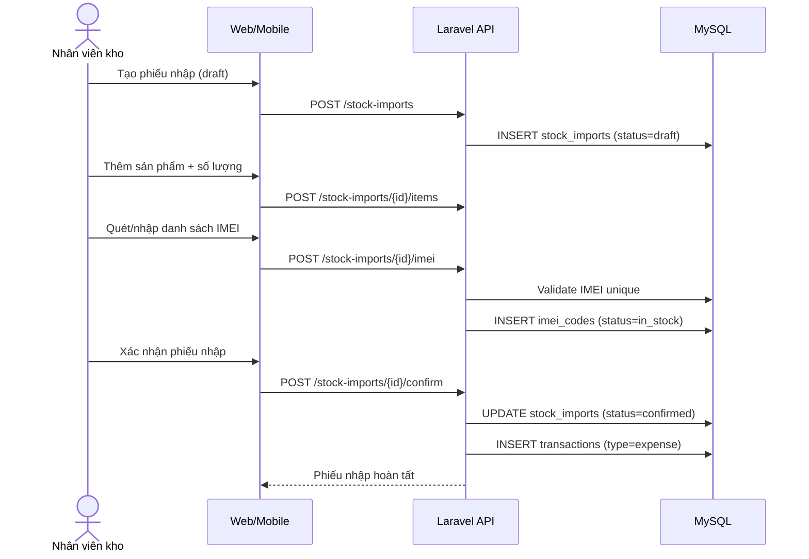
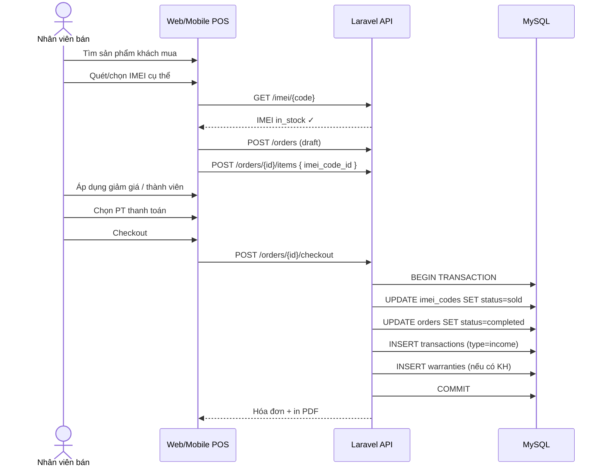
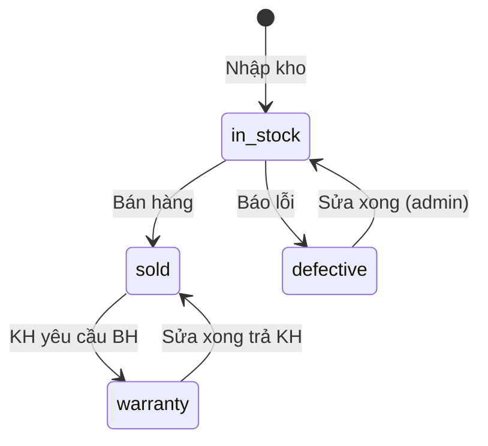

# Luồng Nghiệp Vụ

## 1. Luồng Nhập Hàng & Khởi Tạo Dòng Chi



**Quy tắc**:
- Số IMEI nạp vào phải khớp tổng quantity của các items.
- Confirm không thể hoàn tác — chỉ admin mới cancel (và phải kiểm tra IMEI chưa bán).

---

## 2. Luồng Bán Hàng POS & Xuất Kho



**Quy tắc**:
- Mỗi order_item gắn đúng 1 IMEI.
- IMEI phải `in_stock` tại thời điểm checkout.
- Dùng DB transaction để tránh bán trùng IMEI.

---

## 3. Luồng Tra Cứu Bảo Hành

```
Input: IMEI (15 số)
  ↓
GET /warranties/lookup/{imei}
  ↓
Trả về: Thông tin máy, KH, ngày bắt đầu/kết thúc BH, lịch sử sửa chữa
```

---

## 4. Luồng Báo Cáo Lãi/Lỗ

```
Doanh thu = SUM(transactions WHERE type=income AND period)
Chi phí  = SUM(transactions WHERE type=expense AND period)
Lợi nhuận gộp = Doanh thu - Chi phí

Chi tiết theo:
  - Ngày / Tuần / Tháng
  - Phương thức thanh toán
  - Danh mục chi (expense_categories)
```

---

## 5. Trạng thái IMEI



| Status | Mô tả |
|--------|-------|
| `in_stock` | Trong kho, sẵn sàng bán |
| `sold` | Đã bán |
| `defective` | Máy lỗi, không bán được |
| `warranty` | Đang trong quy trình bảo hành |
